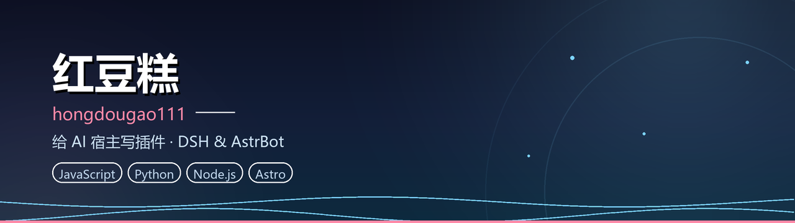

  

### 红豆糕 · hongdougao111

> 给 AI 宿主写插件。都是从小麻烦开始的。

我做两类东西：**DeepSeek Harness 的插件**，和 **AstrBot 的插件**。
共同点是——起因几乎都是「这也太烦了，我自己写个」。
（所以我的 README 都比较长，因为我想讲清楚那个麻烦到底是什么。）

---

## 🔌 DeepSeek Harness

<table>
<tr>
<td width="50%" valign="top">

**[dsh-power-switch](https://github.com/hongdougao111/dsh-power-switch)**  
`JavaScript` · `2 ★`

右上角一枚电源键。点一下 DSH 进程**真的**没了，再点一下又爬起来——不是 `location.reload()` 那种假动作。

</td>
<td width="50%" valign="top">

**[dsh-archive-trash](https://github.com/hongdougao111/dsh-archive-trash)**  
`JavaScript` · `2 ★`

DSH 的「归档」只是从侧栏消失，文件还在原地吃硬盘。这个补上删除，以及后悔药：回收站可还原、可彻底删、正在跑的会话不给删。

</td>
</tr>
</table>

> 顺带维护：[dsh-m](https://github.com/hongdougao111/dsh-m)（插件市场）、[awesome-dsh-plugin](https://github.com/hongdougao111/awesome-dsh-plugin)（插件精选列表）——这两个是 fork，原始作者不是我。

---

## 🎮 AstrBot

<table>
<tr>
<td width="50%" valign="top">

**[astrbot_plugin_proactive_companion](https://github.com/hongdougao111/astrbot_plugin_proactive_companion)**  
`Python` · `3 ★`

让 Bot 主动开口。读群气氛、记得好感度、有会衰减的情绪、23:00 之后闭嘴，还自带 WebUI。**不是定时刷屏**。

</td>
<td width="50%" valign="top">

**[astrbot_plugin_dongsen_voice](https://github.com/hongdougao111/astrbot_plugin_dongsen_voice)**  
`Python` · `1 ★`

让 Bot 用动森村民的腔调说话。从 407 个真人录制的普通话音节里拼接，不联网、不要 GPU、不要 ffmpeg。

</td>
</tr>
<tr>
<td colspan="2" valign="top">

**[qunyou-xiaozhuan-CCB](https://github.com/hongdougao111/qunyou-xiaozhuan-CCB)**  
`Python`

红豆币爆仓模拟器。八种货币对、开杠杆、真的会爆仓。题材借鉴《FX战士久留美》，但角色与数值全原创。

</td>
</tr>
</table>

---

## 🧰 工具

  
  
  
  
  

轻量喜欢 `HTML` / `CSS` / `Astro`（[Firefly](https://github.com/hongdougao111/Firefly) 主题 fork 自 [cuteleaf](https://github.com/cuteleaf)）

---

**我在意的事**

- 插件的 README 要写清「它救你于什么水火」，不是只列功能
- 所谓「重启生效」不该靠用户去任务管理器里猜 `node.exe`
- 删除功能默认要有回收站；没有就写一个

---

  📮 有问题直接开 Issue，我基本都会回。

